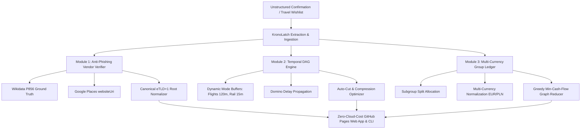

# KronoLatch ⏱️🛡️

> **Deterministic-First, Agent-Assisted Trip Orchestrator, Anti-Phishing Ticket Domain Verifier, Temporal DAG Itinerary Validator & Multi-Currency Group Expense Splitter.**

[](https://github.com/FranekJemiolo/kronolatch/actions/workflows/ci.yml)
[](https://www.python.org/downloads/)
[](https://github.com/astral-sh/uv)
[](LICENSE)
[](#offline-first-philosophy)

---

## 🧭 Why KronoLatch?

Modern travel planning is plagued by three persistent failure modes:
1. **SEO-Poisoned Reseller Clones:** Predatory third-party websites outrank official monument and railway portals on search ads, charging 100%–250% markups for basic entry tickets.
2. **Domino-Effect Transit Collisions:** A 35-minute regional rail delay causes a cascade of missed timed-entry slots at museums or connecting flights because traditional itineraries treat trips as static bullet lists rather than directed acyclic graphs (DAGs).
3. **Fragmented Group Expenses:** Uneven multi-modal splits (e.g., 2 passengers on high-speed rail while 2 rent a car, with parking paid in PLN and meals paid in EUR) result in tedious manual debt reconciliation.

**KronoLatch** solves these pain points through a **deterministic-first, agent-assisted architecture**: AI agents handle messy text extraction and discovery, while a zero-hallucination deterministic engine computes buffer mathematics, canonical root domain matching, and minimum-cash-flow debt settlement.

---

## 🏛️ Core Architectural Pillars



### 1. Anti-Phishing Official Vendor Verifier
- Strips subdomains to canonical **eTLD+1** root domains.
- Anchors against authoritative Wikidata entity properties (`P856`) and Google Places API (`websiteUri`).
- Detects deceptive keywords (`-tickets`, `-fast-track`, `-official`) and $>15\%$ markups to block scam clones.

### 2. Temporal DAG Engine & Dynamic Leeway
- Models every day as a Directed Acyclic Graph enforcing:
  $$\text{Total Transition Time} = T_{\text{transit}} + T_{\text{overhead}} + \lceil T_{\text{transit}} \times \alpha_{\text{risk}} \rceil + B_{\text{fixed}}$$
- Automatic mode rules:
  - **Flights:** $T_{\text{overhead}} = 120\text{ min}$, $\alpha_{\text{risk}} = 0.15$
  - **Trains / Buses:** $T_{\text{overhead}} = 15\text{ min}$, $\alpha_{\text{risk}} = 0.20$
  - **Rental Cars:** $T_{\text{overhead}} = 15\text{ min}$, $\alpha_{\text{risk}} = 0.25$
  - **Walking:** $T_{\text{overhead}} = 5\text{ min}$, $\alpha_{\text{risk}} = 0.10$
- **Auto-Cut Optimizer:** Automatically compresses flexible stops towards their `min_duration_min` or trims lowest-priority stops to resolve downstream hard conflicts.

### 3. Multi-Currency Group Ledger
- Contextually links expenditures to itinerary nodes.
- Handles asymmetric subgroup shares (e.g. car subgroup vs rail subgroup).
- Computes net balances in base currency and executes a deterministic greedy graph reduction algorithm to settle all debts in the absolute minimum number of peer-to-peer transfers.

### 4. Portable Agent Skills & Rules
- Exportable system instructions and tool harnesses for **Gemini Gems**, **Google Antigravity IDE (`.antigravity/skills/`)**, and **Cursor (`.cursorrules`)**.

---

## ⚡ Quickstart (Python CLI)

KronoLatch is managed with [`uv`](https://github.com/astral-sh/uv).

### 1. Installation & Verification
```bash
# Clone the repository
git clone https://github.com/FranekJemiolo/kronolatch.git
cd kronolatch

# Run automated unit tests
uv run pytest

# Run on-demand architectural self-test suite
uv run kronolatch self-test
```

### 2. CLI Usage Examples

#### Audit Itinerary & Simulate Delays
```bash
# Validate default Rome & Florence corridor
uv run kronolatch validate

# Inject a 35-minute delay on the Leonardo Express train and auto-cut lowest-priority stop
uv run kronolatch validate --inject-delay n2:35 --auto-cut
```

#### Anti-Phishing Domain Verifier
```bash
# Test an SEO clone against Colosseum official ticketing
uv run kronolatch verify-url "https://www.colosseum-rome-tickets.org/fast-track" \
  --venue "Parco Archeologico del Colosseo" \
  --price 44.00 \
  --official-price 18.00
```

#### Group Expense Settlement
```bash
# Settle multi-currency expenses into minimum peer-to-peer transfers
uv run kronolatch settle
```

#### Export Agent Skills
```bash
# Export system prompt for Gemini Gems or Antigravity IDE
uv run kronolatch export-skill --target gemini --dest "Rome & Florence"
uv run kronolatch export-skill --target antigravity
```

---

## 🌐 Static Web App & PWA (GitHub Pages)

The `/web` folder contains a 100% client-side, zero-cloud-cost Progressive Web App designed with a pleasant, welcoming palette:

- **Tab 1: Temporal DAG & Leeway Optimizer** — Interactive sliders for risk multiplier ($\alpha_{\text{risk}}$), station buffer, and simulated delay injection with live conflict indicators and one-click auto-cut.
- **Tab 2: Official Domain & Ticket Anti-Phishing Verifier** — Real-time URL auditor with scam clone detection, price markup comparison, and preset comparisons.
- **Tab 3: Multi-Modal Group Expense Ledger** — Uneven subgroup splits, multi-currency conversion, and minimal settlement graph.
- **Tab 4: Interactive Skill, CLI & Manual Test Studio** — Live generation of `SKILL.md`, `.cursorrules`, and interactive test runner.

### Local Web Preview
```bash
python3 -m http.server -d web 8080
# Open http://localhost:8080 in your browser
```

---

## 🔑 Optional BYOK (Bring Your Own Key) Setup

KronoLatch operates 100% offline using its curated ground-truth database. To enable live web lookups:
- **Google Maps Places API (New):**
  Export `GOOGLE_MAPS_API_KEY="AIzaSy..."` to enable dynamic live `websiteUri` queries.
- **Gemini 2.5 / Flash API:**
  Enter your Gemini API key in Tab 4 of the web app to extract messy confirmation emails or tickets directly in the browser.

---

## 🧪 Automated & Manual Verification Suite

See [`tests/manual_ai_verification.md`](tests/manual_ai_verification.md) for the complete test protocol containing:
1. **The SEO Ticket Trap** (Anti-Phishing Assertion)
2. **Cascading Regional Rail Delay** (Temporal DAG Assertion)
3. **Asymmetric Subgroup Cost Split** (Ledger Assertion)
4. **Unstructured Booking Ingestion to Valid Schema** (Ingestion Assertion)

---

## 📄 License
MIT License. Created for frictionless, stress-free group exploration.
