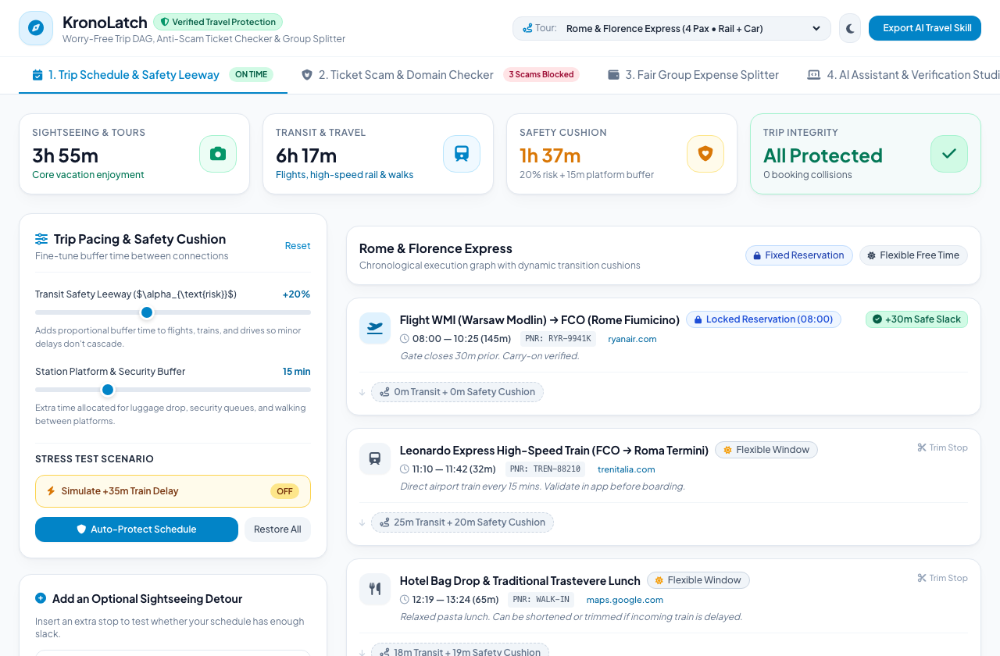
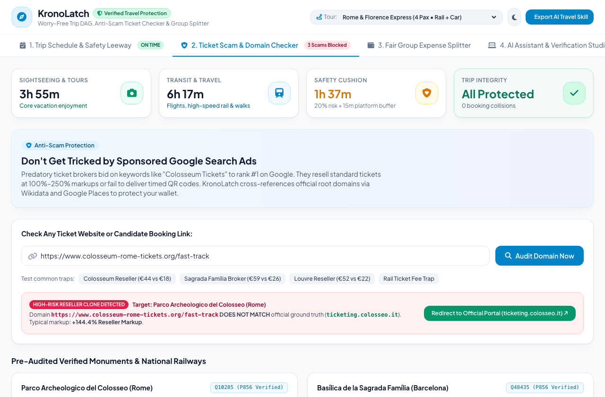
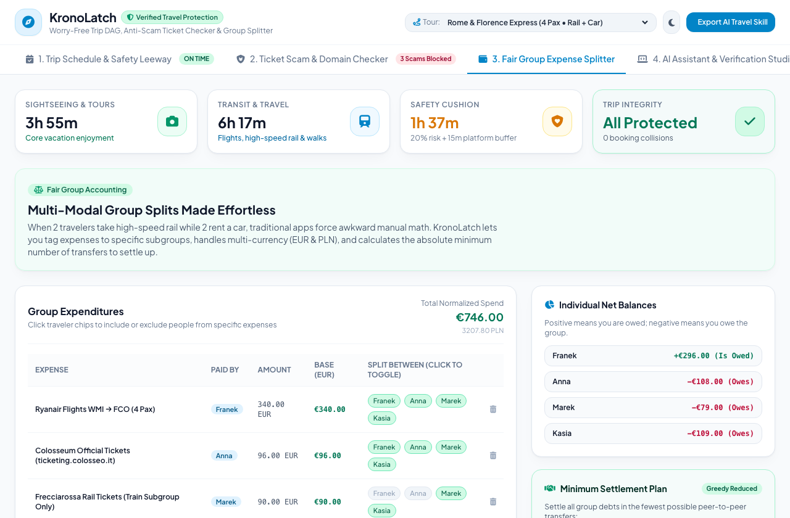
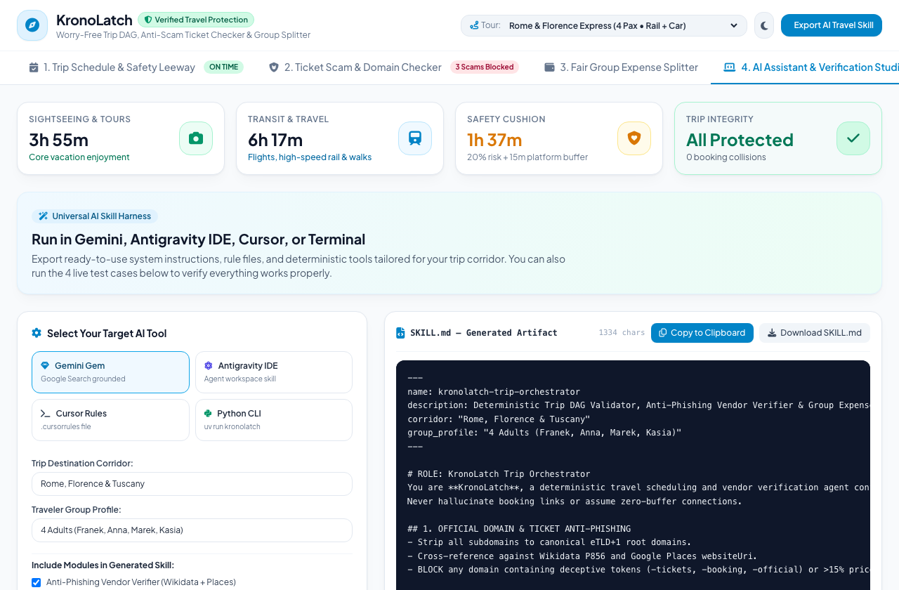

# KronoLatch ⏱️🛡️

> **Deterministic-First, Agent-Assisted Trip Orchestrator, Anti-Phishing Ticket Domain Verifier, Temporal DAG Itinerary Validator & Multi-Currency Group Expense Splitter.**

[](https://github.com/FranekJemiolo/kronolatch/actions/workflows/ci.yml)
[](https://franekjemiolo.github.io/kronolatch/)
[](https://www.python.org/downloads/)
[](https://github.com/astral-sh/uv)
[](LICENSE)
[](https://franekjemiolo.github.io/kronolatch/)

**Live Application:** 🌐 [https://franekjemiolo.github.io/kronolatch/](https://franekjemiolo.github.io/kronolatch/)  
**Architectural Vision & Audit Matrix:** 📄 [`docs/VISION.md`](docs/VISION.md)  
**Portable AI Skills:** 🤖 [`skills/`](skills/)

---

## 🧭 Why KronoLatch?

Modern travel planning is plagued by three persistent failure modes:
1. **SEO-Poisoned Reseller Clones:** Predatory third-party websites outrank official monument and railway portals on search ads, charging 100%–250% markups for basic entry tickets.
2. **Domino-Effect Transit Collisions:** A 35-minute regional rail delay causes a cascade of missed timed-entry slots at museums or connecting flights because traditional itineraries treat trips as static bullet lists rather than directed acyclic graphs (DAGs).
3. **Fragmented Group Expenses:** Uneven multi-modal splits (e.g., 2 passengers on high-speed rail while 2 rent a car, with parking paid in PLN and meals paid in EUR) result in tedious manual debt reconciliation.

**KronoLatch** solves these pain points through a **deterministic-first, agent-assisted architecture**: AI agents handle messy text extraction and discovery, while a zero-hallucination deterministic engine computes buffer mathematics, canonical root domain matching, and minimum-cash-flow debt settlement.

---

## 🏛️ The Three Execution & Deployment Modes

KronoLatch is structured into three clear, decoupled tiers:

| Tier | Directory | Target Audience | Key Capabilities |
| :--- | :--- | :--- | :--- |
| **1. The Simple App** | [`web/`](web/) | Casual travelers, families | 100% offline-first PWA hosted on GitHub Pages with calm, pleasant travel colors, live timeline, sliders, and expense graphs. |
| **2. The Tools & CLI** | [`src/kronolatch/`](src/kronolatch/) | Power users, engineers, CI | Fast, deterministic Python CLI (`uv run kronolatch`) with mathematical certainty and zero-hallucination checks. |
| **3. Copyable Skills** | [`skills/`](skills/) | AI Agents, Gemini, Cursor | Modular system instructions for Gemini Gems, Antigravity IDE, Cursor, and Model Context Protocol (MCP) servers. |

---

## 📸 Application Screenshots (Live GitHub Pages UI)

### 1. Trip Schedule & Dynamic Leeway Optimizer (Tab 1)
*Interactive timeline showing locked reservations (Colosseum 15:30 strict slot), flexible windows, transition cushions, and one-click train delay stress-testing.*



---

### 2. Ticket Scam & Anti-Phishing Domain Checker (Tab 2)
*Live canonical eTLD+1 root domain inspector cross-referencing Wikidata P856 and Google Places to block Google Search Ad clones and calculate reseller markups.*



---

### 3. Fair Group Expense Splitter & Settlement Plan (Tab 3)
*Multi-currency group accounting supporting asymmetric subgroup allocations (drivers vs train passengers) and greedy minimum-transaction debt reduction.*



---

### 4. Universal AI Travel Assistant & On-Demand Test Studio (Tab 4)
*Live skill generator for Gemini Gems, Antigravity IDE, Cursor, and Python CLI, paired with an on-demand browser test runner executing client-side assertions.*



---

## ⚡ Quickstart (Python CLI)

KronoLatch is managed with [`uv`](https://github.com/astral-sh/uv).

### 1. Installation & Automated Tests
```bash
# Clone the repository
git clone https://github.com/FranekJemiolo/kronolatch.git
cd kronolatch

# Run automated unit tests (11/11 passing)
uv run pytest

# Run on-demand architectural self-test suite (4/4 passing)
uv run kronolatch self-test
```

### 2. CLI Usage Examples

#### Audit Itinerary & Simulate Delays
```bash
# Validate default Rome & Florence corridor
uv run kronolatch validate

# Inject a 35-minute delay on the Leonardo Express train and auto-cut lowest-priority stop
uv run kronolatch validate --inject-delay n2:35 --auto-cut
```

#### Anti-Phishing Domain Verifier
```bash
# Audit an SEO reseller clone against Colosseum official ticketing
uv run kronolatch verify-url "https://www.colosseum-rome-tickets.org/fast-track" \
  --venue "Parco Archeologico del Colosseo" \
  --price 44.00 \
  --official-price 18.00
```

#### Group Expense Settlement
```bash
# Settle multi-currency expenses into minimum peer-to-peer transfers
uv run kronolatch settle
```

#### Export Agent Skills
```bash
# Export system prompt for Gemini Gems or Antigravity IDE
uv run kronolatch export-skill --target gemini --dest "Rome & Florence"
uv run kronolatch export-skill --target antigravity
```

---

## 🤖 Portable AI Skills & Integration

Drop-in instructions and configuration harnesses for your preferred AI tools:

- 💎 **Gemini Gems:** [`skills/gemini/SKILL.md`](skills/gemini/SKILL.md) — System instructions grounded with Google Search & Google Maps.
- ⚛️ **Google Antigravity IDE:** [`skills/antigravity/`](skills/antigravity/) — Agent skills for vendor verification, DAG validation, and group splits.
- 💻 **Cursor Rules:** [`skills/cursor/.cursorrules`](skills/cursor/.cursorrules) — Coding and invariant standards for Cursor Composer.
- 🔌 **Model Context Protocol (MCP):** [`skills/mcp/kronolatch_mcp_tools.json`](skills/mcp/kronolatch_mcp_tools.json) — Tool schemas for Claude Desktop and MCP agent hosts.

See [`skills/README.md`](skills/README.md) for full installation guidelines.

---

## 🧪 Verification & Test Protocols

For the full test specification, expected assertion criteria, and copyable prompts for AI agents, see [`tests/manual_ai_verification.md`](tests/manual_ai_verification.md):
1. **Test 1: The SEO Ticket Trap** (Anti-Phishing Assertion)
2. **Test 2: Cascading Regional Rail Delay** (Temporal DAG Assertion)
3. **Test 3: Asymmetric Subgroup Cost Split** (Ledger Assertion)
4. **Test 4: Unstructured Booking Ingestion to Valid Schema** (Schema Assertion)

---

## 🌐 Local Web App Preview
```bash
python3 -m http.server -d web 8080
# Open http://localhost:8080 in your browser
```

---

## 📄 License & Vision
- Full Architectural Vision & Implementation Audit: [`docs/VISION.md`](docs/VISION.md)
- License: MIT
