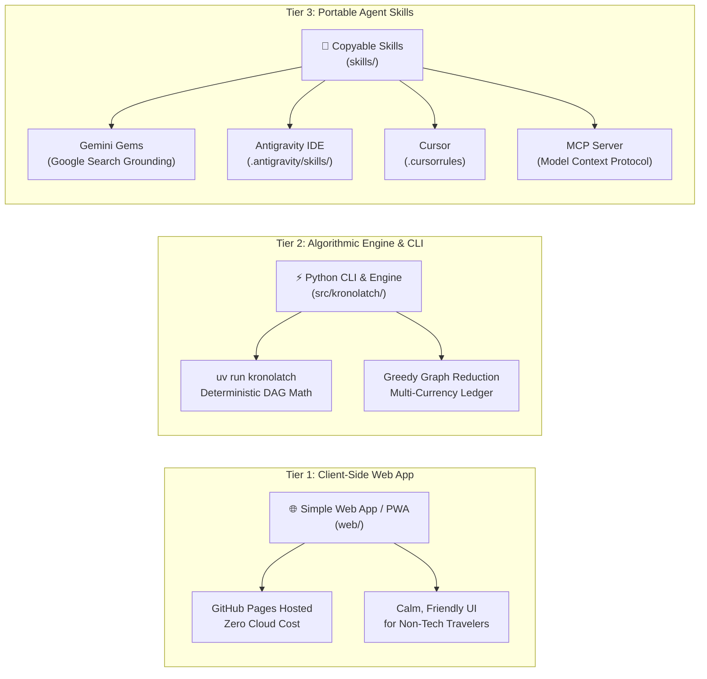

# KronoLatch Portable AI Skills & Integration Harnesses 🤖

This directory contains pre-configured, copy-pasteable skills, system prompts, and configuration rules for integrating KronoLatch's deterministic travel verification engine into leading GenAI and Agent platforms.

---

## 🧭 Distinct Execution Modes in KronoLatch

To ensure clean separation of concerns, KronoLatch is organized into three distinct tiers:

| Tier | Directory | Primary Audience | Key Characteristics |
| :--- | :--- | :--- | :--- |
| **1. The Simple App** | [`web/`](file:///Users/franek/personal_workspace/kronolatch/web) | Casual travelers, families, non-programmers | Zero-install, 100% offline-first PWA, visual timeline, interactive sliders, calm & friendly palette. |
| **2. The Tools & CLI** | [`src/kronolatch/`](file:///Users/franek/personal_workspace/kronolatch/src/kronolatch) | Power users, automation scripts, engineers | Fast, deterministic Python CLI (`uv run kronolatch`), zero-hallucination buffer math, automated CI test suite. |
| **3. Copyable Skills** | [`skills/`](file:///Users/franek/personal_workspace/kronolatch/skills) | AI Agents, Gemini users, Antigravity IDE, Cursor | Modular prompt instructions and tool schemas that can be copy-pasted into any LLM environment. |

---

## 📂 Available Skills Directory

### 1. [Gemini Gems (`skills/gemini/SKILL.md`)](file:///Users/franek/personal_workspace/kronolatch/skills/gemini/SKILL.md)
- **Target:** Google Gemini (Gemini Advanced, Gemini 2.5 / Flash, Custom Gems).
- **Setup:** Create a new custom Gem in Gemini, paste the contents of `skills/gemini/SKILL.md` into the **Instructions** box, and ensure the **Google Search** and **Google Maps** extensions are toggled on.
- **Usage:** Paste raw wishlists (e.g. *"Plan 3 days in Rome for 4 people, 2 taking rail, 2 renting a car"*) and ask Gemini to audit official ticket links.

### 2. [Antigravity IDE (`skills/antigravity/`)](file:///Users/franek/personal_workspace/kronolatch/skills/antigravity)
- **Target:** Google Antigravity IDE / Antigravity 2.0 Agentic Workspaces.
- **Contents:**
  - [`official-vendor-verifier.md`](file:///Users/franek/personal_workspace/kronolatch/skills/antigravity/official-vendor-verifier.md): Anti-phishing domain auditor.
  - [`temporal-itinerary-validator.md`](file:///Users/franek/personal_workspace/kronolatch/skills/antigravity/temporal-itinerary-validator.md): Deterministic DAG time-budget math and buffer rules.
  - [`group-split-reconciler.md`](file:///Users/franek/personal_workspace/kronolatch/skills/antigravity/group-split-reconciler.md): Multi-currency group ledger and minimal settlement.
- **Setup:** Drop the markdown files into your trip project's `.antigravity/skills/` directory.

### 3. [Cursor (`skills/cursor/.cursorrules`)](file:///Users/franek/personal_workspace/kronolatch/skills/cursor/.cursorrules)
- **Target:** Cursor Composer & Windsurf.
- **Setup:** Save to the root of your trip repository as `.cursorrules` to instruct the AI agent to follow KronoLatch buffer invariants and root domain normalization.

### 4. [Model Context Protocol (`skills/mcp/kronolatch_mcp_tools.json`)](file:///Users/franek/personal_workspace/kronolatch/skills/mcp/kronolatch_mcp_tools.json)
- **Target:** Claude Desktop, Cursor MCP, or any MCP-compatible agent host.
- **Setup:** Add the tool schema definitions to your `claude_desktop_config.json` or MCP server manifest.
